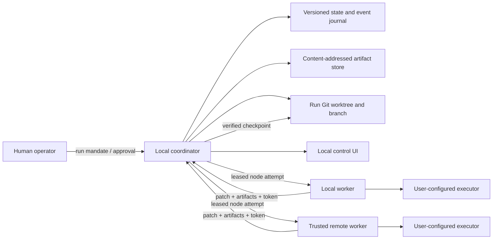

# Agent Graph Runtime — target architecture

Status: proposed target architecture. This document describes intended future
behavior and does not override the implemented v0.6 contract in
[`SPEC.md`](SPEC.md).

## Product boundary

Agent Graph Runtime is a local-first control plane for repository work. One
human operator starts a run and supplies already-installed Codex, Claude Code,
or Claudex executors. The runtime coordinates work, owns lifecycle state,
verifies worker results, records evidence, and preserves a reversible Git
history. It is not a SaaS product and does not own model accounts, provider
credentials, or provider routing.

The target user outcome is:

> Start a bounded repository objective, allow the runtime to decompose and
> execute authorized work locally or on trusted user-owned workers, inspect an
> auditable result, and integrate or revert it without touching unrelated work.

## Accepted architecture decisions

### Local-first, not multi-tenant

- The coordinator, state store, artifacts, UI, policies, and Git worktrees run
  on infrastructure controlled by the user.
- No organization, tenant, subscription, or hosted billing model is required.
- The default UI binds to loopback. Remote access is an explicit self-hosted
  configuration, not a product default.
- Source code leaves user-controlled machines only through an executor the user
  selected and configured. The runtime makes no separate model-provider call.

### The human is the authority principal

- Agents and workers can propose work and return results; they cannot grant
  themselves authority.
- Human decisions are recorded as approval receipts or bounded run mandates.
- A deterministic policy may exercise authority already delegated by a human,
  but it cannot expand that authority.
- Unknown, destructive, costly, irreversible, or third-party effects stop for
  a human decision.

### The coordinator is the only run-state writer

- Workers never mutate canonical run state, the canonical checkout, approvals,
  or accepted evidence.
- Workers return a result proposal: patch, artifacts, observed usage, and a
  structured handoff.
- The coordinator validates the active lease, fencing token, ownership,
  artifact hashes, and checks before accepting a result.
- External actions execute only under coordinator control.

### Executors remain provider-agnostic

- Codex, Claude Code, and Claudex authentication stays user-owned.
- The coordinator stores no model API keys.
- Provider name and model usage are observed evidence when an executor exposes
  them, not scheduler-owned configuration truth.
- Claudex retains ownership of proxy routing, effort, compaction, and context
  window settings.

### One run is one reversible Git transaction

- A writing run executes in an isolated worktree and run branch created from an
  exact base commit.
- Accepted waves create append-only checkpoint commits on the run branch.
- A completed run produces one immutable `RunResult` pointing to its base,
  checkpoints, final commit, plan revision, and evidence digest.
- The user checkout and target branch are not mutated until an explicit
  `agr integrate` operation.
- Rollback creates a revert commit. The runtime does not rewrite shared history
  or use destructive reset as a product operation.

## Target topology



Workers are compute peers, not authority peers. Coordinator checks establish
whether a result may be accepted; they do not make an untrusted machine safe to
receive source code or secrets. Remote workers must therefore be user-owned and
registered, or receive a deliberately sanitized and sandboxed snapshot.

## Core domain model

### Run and plan revisions

```ts
interface RunIdentity {
  runId: string;
  objective: string;
  baseCommit: string;
  repositoryId: string;
  createdAt: string;
}

interface PlanRevision {
  revisionId: string;
  runId: string;
  parentRevisionId?: string;
  graphHash: string;
  createdBy: "human" | `attempt:${string}`;
  sourceEvidence: ArtifactRef[];
  status: "proposed" | "validated" | "active" | "superseded" | "rejected";
}
```

An active wave always runs against one immutable plan revision. Dynamic graph
expansion never mutates an executing graph in place.

### Graph patches

An agent may propose a `GraphPatch` between waves. The coordinator validates:

- dependency existence and cycle freedom;
- ownership and resource conflicts;
- node, depth, time, and cost budgets;
- executor capability and availability;
- mandate scope and action authority;
- evidence references and proposal provenance.

After validation, the patch creates a new immutable `PlanRevision`. It becomes
active only at a wave boundary. Rejection is recorded as evidence and does not
alter the active revision.

### Attempts and immutable evidence

```ts
interface AttemptRecord {
  attemptId: string;
  nodeId: string;
  planRevisionId: string;
  generation: number;
  ordinal: number;
  workerId?: string;
  leaseId?: string;
  fencingToken?: number;
  status:
    | "created"
    | "leased"
    | "running"
    | "completed"
    | "accepted"
    | "failed"
    | "needs_attention"
    | "superseded";
  evidence: ArtifactRef[];
}

interface ArtifactRef {
  artifactId: string;
  kind: string;
  sha256: string;
  size: number;
  producerAttemptId?: string;
  localPath: string;
}
```

Attempt IDs are globally unique, per-node ordinals are monotonic, and evidence
paths are never reused. Manual retry creates a new generation or attempt and
marks prior accepted descendants as superseded; it does not delete their
evidence or reset their identity.

### Run mandates and approval receipts

```ts
interface RunMandate {
  mandateId: string;
  issuedBy: "human";
  planRevisionId: string;
  allowedActions: string[];
  allowedTargets: string[];
  maxNodes: number;
  maxDepth: number;
  maxDurationMs: number;
  maxCostUsd?: number;
  policyHash: string;
  issuedAt: string;
  expiresAt: string;
}

interface ApprovalReceipt {
  approvalId: string;
  issuedBy: "human" | `policy:${string}`;
  mandateId?: string;
  target: string;
  actionParametersHash: string;
  planRevisionId: string;
  repositoryFingerprint: string;
  dependencyEvidenceDigest: string;
  reason?: string;
  issuedAt: string;
  expiresAt?: string;
}

interface ApprovalReservation {
  reservationId: string;
  approvalId: string;
  attemptId: string;
  actionParametersHash: string;
  reservedAt: string;
}

interface ApprovalConsumption {
  reservationId: string;
  consumedAt: string;
}
```

A policy authorization is not an agent approval. It is a deterministic decision
within a human-issued mandate. Approval receipts are single-use by default and
become invalid when their plan revision, repository fingerprint, action
parameters, or dependency evidence changes.
Reservation and consumption are separate append-only records, so a crash between
them remains representable and enters reconciliation by reservation ID. An
issued receipt is never rewritten after its digest is established.

## Git transaction model

### Run creation

1. Resolve and record the exact repository and base commit.
2. Preserve the user's active checkout and dirty work.
3. Create a run branch and worktree under the repository's configured
   `.worktrees/` area.
4. Record the worktree path, branch, base commit, initial tree fingerprint, and
   graph revision in state.
5. Never stage `.agent-graph` runtime state into the product commit.

Read-only runs may operate without a worktree when they cannot modify the
repository. Writing runs default to isolation.

### Commit boundary between runs

- Every writing run starts from an exact commit, never from another run's
  uncommitted worktree state.
- A dependent next run starts from either an explicitly integrated result commit
  or an explicitly selected prior `RunResult.resultCommit`.
- Independent runs may branch from the same base commit and remain isolated.
- A failed or cancelled run cannot become another run's implicit base.
- Chaining runs records the parent run ID and result commit so rollback and
  invalidation can follow the complete lineage.

### Checkpoints

- A checkpoint is created only after node outcomes, ownership, artifacts, and
  deterministic checks for the wave have been accepted.
- Checkpoint commit metadata records run ID, plan revision, accepted attempt
  IDs, and evidence digest.
- A failed or cancelled wave may retain diagnostic files and a private run ref,
  but it does not advance the accepted checkpoint.
- Concurrent writers use separate node worktrees or execute serially until
  per-node isolation exists.

### Integration and rollback

`agr integrate <run-id>` verifies that:

- the run is complete and has no unresolved attention state;
- the target branch still descends from or can safely integrate the base;
- evidence and checkpoint hashes still match;
- configured final checks pass from a clean representative checkout;
- the human has approved any material external or target-branch effect.

Integration may fast-forward, cherry-pick, or stop with an explicit conflict.
It does not silently resolve conflicts. Integration appends an immutable
`IntegrationRecord` referencing the unchanged `RunResult`, target branch, and
resulting commit. `agr rollback <run-id>` creates a revert commit and appends an
immutable `RollbackRecord` referencing that integration; it never performs a
destructive reset of user-owned history.

## Coordinator and worker protocol

### Worker registration

A worker has a stable identity and declared capabilities:

```ts
interface WorkerCapabilities {
  workerId: string;
  operatingSystem: string;
  architecture: string;
  executors: string[];
  maxConcurrency: number;
  resources: string[];
}
```

Registration establishes transport identity, not result trust. Initial remote
deployment assumes user-owned workers. Mutual TLS or a scoped enrollment token
is required before LAN execution; the exact transport is an implementation ADR.

### Lease and fencing

- The coordinator grants a bounded lease for one `AttemptRecord`.
- Every lease carries a monotonically increasing fencing token.
- Heartbeats may extend the active lease but cannot change attempt authority.
- A late result with an expired or superseded token is rejected.
- Work may be delivered at least once; result acceptance is idempotent and only
  one completion can become accepted.
- Workers never receive coordinator approval credentials or state-store access.

### Result acceptance

The worker returns a patch bundle, content-addressed artifacts, executor output,
and structured handoff. The coordinator then:

1. validates worker identity, lease, fencing token, and attempt state;
2. validates artifact hashes and patch ownership;
3. applies the patch to a clean integration worktree;
4. reruns coordinator-owned deterministic checks;
5. records evidence before transitioning the attempt;
6. creates the accepted checkpoint only after every invariant passes.

External actions remain coordinator-local. No worker, local or remote, may
dispatch or claim completion of an external action. A worker may prepare an
action plan, but only the coordinator action service may publish, deploy, send,
delete, or pay after durable authority reservation and consumption.

## Storage model

The domain depends on semantic storage contracts rather than one database:

```ts
interface EventJournal {
  append(runId: string, expectedRevision: number, events: DomainEvent[]): Promise<number>;
  read(runId: string, afterSequence: number): Promise<DomainEvent[]>;
}

interface ArtifactStore {
  putImmutable(content: Uint8Array, metadata: ArtifactMetadata): Promise<ArtifactRef>;
  verify(reference: ArtifactRef): Promise<boolean>;
}

interface LeaseStore {
  acquire(resource: string, owner: string, ttlMs: number): Promise<Lease>;
  renew(lease: Lease): Promise<Lease>;
  release(lease: Lease): Promise<void>;
}
```

Planned implementations:

1. filesystem artifacts and versioned JSON/event files during v0.7 migration;
2. coordinator-owned SQLite with WAL for local and multi-worker execution;
3. optional PostgreSQL only if multiple coordinators or high availability
   become real requirements.

Workers communicate with the coordinator API and never access the database
directly.

## Resource model

Path ownership is necessary but does not cover shared runtime resources. Nodes
may declare named leases:

```json
{
  "resources": [
    { "name": "browser:profile:default", "mode": "exclusive" },
    { "name": "provider:claudex", "mode": "shared", "limit": 2 }
  ]
}
```

Initial resource types include browser profiles, ports, databases, Docker
environments, GPUs, provider concurrency, and external targets. The scheduler
must satisfy dependencies, path isolation, resource leases, and mandate budgets
before dispatch.

## Local control UI

The UI consumes a read model and sends commands through the same application
services as the CLI. It never edits persisted state directly.

Initial surfaces:

- runs, revisions, waves, attempts, and worker leases;
- current stop reason and required operator decision;
- evidence, artifact hashes, and Git checkpoints;
- mandates, approval receipts, and external-action reconciliation;
- integrate and revert previews;
- time, cost, context, and resource budgets.

The default server binds to `127.0.0.1`, but loopback is not an authentication
boundary. Every browser session receives an unguessable, short-lived capability;
the server enforces strict Host and Origin allowlists, CSRF protection, and no
wildcard CORS. WebSocket and form command paths use the same checks. Mutating
commands still require their command-specific preview and authority validation.
LAN access additionally requires explicit listen configuration, authenticated
enrollment, and protected transport.

## Retention policy

Until the user configures retention, the safe default is manual pruning:

- state, events, approval receipts, and Git lineage are retained;
- failed runs and external-action evidence are never auto-pruned;
- raw executor output remains local and access-restricted;
- `agr retention plan` previews eligible data;
- `agr prune --dry-run` is required before explicit deletion;
- pruning retains a minimal manifest with hashes, lineage, deletion time, and
  policy reason.

Automatic age- or size-based pruning is a later opt-in policy. Secret redaction
and local file permissions apply before retention, not only during export.

## Non-negotiable invariants

1. The coordinator is the only authority that transitions run state.
2. Plan revisions, attempts, events, evidence, and approval receipts are
   append-only or superseded, never silently rewritten.
3. A failed, interrupted, or uncertain external action never retries
   automatically.
4. A worker result is a proposal until coordinator verification accepts it.
5. A stale worker cannot commit a result after losing its fencing token.
6. An approval cannot authorize different code, evidence, target, or parameters
   than the operator reviewed.
7. A writing run does not mutate the user's active checkout.
8. Integration and rollback preserve Git history and require explicit commands.
9. Dynamic graph expansion is budgeted, provenance-linked, validated, and
   activated only between waves.
10. The runtime never stores provider credentials or broadens executor authority.

## Explicit non-goals

- Multi-tenancy, organizations, subscriptions, and SaaS billing.
- Runtime-owned model-provider accounts or direct provider APIs.
- Agent-generated authority or LLM-based policy decisions.
- Silent conflict resolution, force push, history rewriting, or destructive
  rollback.
- Multiple active coordinators before a real high-availability requirement.
- Automatic execution on unregistered third-party workers.

## Remaining implementation decisions

- Worker enrollment transport: mutual TLS versus scoped enrollment tokens.
- Patch bundle format and treatment of binary or generated artifacts.
- Default raw-log retention once real disk usage is measured.
- Whether final integration produces a merge commit or one squashed run commit
  by default; both must retain checkpoint lineage in the run manifest.
- Cost normalization when executors expose incomplete or incomparable usage.
