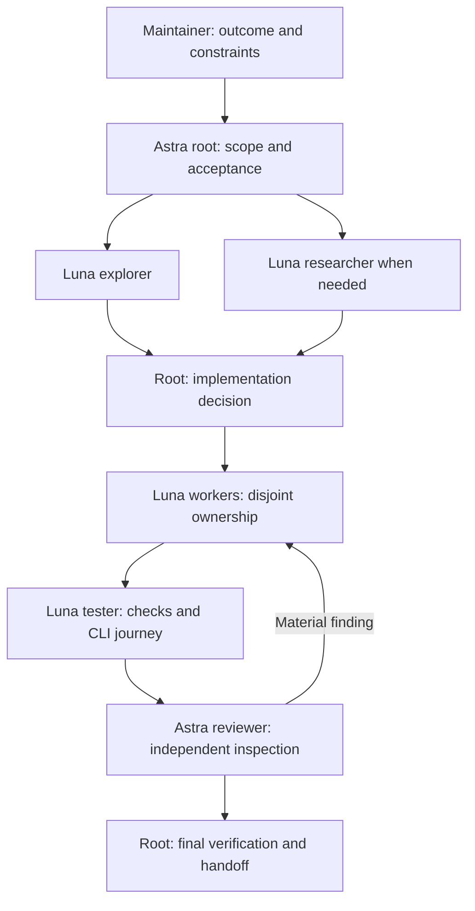

# Developing AGR with a Codex team

## Scope and acceptance

The user is the AGR maintainer working with Codex. The outcome is a project-local
team that can investigate, implement, test, and independently review AGR changes
while the root agent remains responsible for the delivered result.

This setup changes development configuration and instructions only. It does not
change the AGR graph schema, adapters, explicit runtime template models, installed
global skills, personal Codex settings, or publication state. A Codex graph node
targeting this checkout can inherit these project model/effort defaults when its
graph omits them; set both fields explicitly when runtime routing must be stable.

Acceptance criteria and verification:

- **AC1: Discoverable team.** Codex loads the project configuration, five named
  roles, and the `agr-development` skill. Parse the TOML and inspect the actual
  installed Codex configuration/prompt loader without invoking a model.
- **AC2: Bounded ownership.** Each role has a clear result and write policy;
  delegation includes acceptance evidence and escalation boundaries. Inspect the
  instructions against the source tree and perform an independent review.
- **AC3: Runtime separation.** Instructions never authorize hidden delegation
  inside AGR nodes or replace runtime evidence and human gates. Inspect adapter
  boundaries and run existing adapter and Astra/Luna regression coverage.
- **AC4: Usable workflow.** A maintainer can start a trusted Codex session, invoke
  the skill, and follow the implementation/test/review loop. Verify discovery,
  document a representative prompt, and distinguish loader checks from a live
  model-backed workflow.
- **AC5: Transparent participation.** Every participant, including the root,
  records factual work events in an individually assigned journal. Exercise direct
  root logging and read-only participant relay, check the final index and journals,
  preserve sandbox/model settings, and verify logs stay outside Git and the package.

Routing follows the user's selected profile: GPT-6 Astra high for the root,
GPT-6 Astra medium for review, GPT-6 Luna max for execution, four concurrent
children. Model availability
depends on the local client and account. Configuration cannot replace an active
session's model or role catalog. Unsupported settings, missing roles, unavailable
models, and blocked checks must be reported, never silently treated as success.

Main risks are overlapping edits, recursive delegation, inherited permissions,
and declaring success from an agent report instead of observed behavior. The
workflow below assigns one writer per surface and keeps final acceptance with
the root.

## Team and working loop



The routing is GPT-6 Astra `high` for the root, GPT-6 Luna `max` for explorer,
worker, tester, and researcher, and GPT-6 Astra `medium` for reviewer.
Execution roles require `gpt-6-luna`; GPT-5.6 Luna is not an automatic fallback.
If the requested model is unavailable, report the blocker instead of substituting
another model without explicit user authorization. At most four children run
concurrently. Roles are selected for the task; a small local change need not
launch a team. Parallel work is useful only with independent inputs and ownership.

The root writes a bounded brief, owns product/architecture decisions, reconciles
findings, and accepts the final checkout. The tester owns the shared build;
`pnpm build` deletes and recreates `dist`, so simultaneous builds are unsafe.
The reviewer gets fresh context and the original acceptance criteria. Material
fixes go through verification and review again.

## Work logs

For every development task, including a root-only task, the root creates this
local directory before substantive work and shares the index link in a progress
update. Use the current UTC time and a short descriptive slug; choose a fresh
suffix if the directory already belongs to another task. Resume uses the original
directory after reading its index and latest journal entries.

```text
.agent-graph/development/<UTC-timestamp>-<task-slug>/
  index.md
  root.md
  explorer-1.md
  worker-1.md
  tester-1.md
  reviewer-1.md
```

Only create journals for actual participants; the example does not require all
roles. The root assigns a unique participant ID even when several agents have the
same role. Replacements get new IDs and links to the interrupted predecessor.
Each journal has one actual writer. Workers and testers append their own records;
the root appends its own and records relayed entries for read-only participants.
The root alone maintains `index.md` with the goal, scope, acceptance criteria,
repository/revision and relevant dirty state, participant roles, journal links,
delivery modes, current statuses, blockers, and final outcome.

Every entry includes:

```text
## <UTC timestamp> — <event>
- Author: <participant ID>; recorded by: <same ID or root>.
- Status: working | blocked | completed | failed | interrupted.
- Action/result: concise observed work, affected files, or an explicit decision
  with its practical rationale. Include safe verification commands and outcomes.
- Evidence: relevant file, test result, or artifact reference; mark unrun checks.
- Next: next action, exact unblock request, or none at a terminal handoff.
```

Required events are `started`, meaningful `progress`, `decision`, `check`,
`blocked`/`resumed` when applicable, and a terminal `handoff`. Record milestones
and status changes immediately, plus an update at least every 60 seconds during
active work when the tool boundary allows it. A long blocking tool can delay an
entry; record its actual duration/result afterward rather than inventing interim
progress. A tiny task may have just start and handoff entries. `completed` in a
participant's journal means its assigned slice ended; it does not accept the
overall task or substitute for test/runtime evidence.

Read-only participants send the same fields to the parent with a `WORK_LOG` prefix
using the collaboration message tool at each checkpoint. The parent persists them
promptly and identifies the participant as author and itself as recorder. Preserve
the event timestamp; include receipt time if delivery was delayed. A journal header
can identify the author/recorder for all relayed entries. The parent must not claim
it observed an action merely because a participant reported it. If messaging is
unavailable, the participant includes unsent entries in its final handoff; the root
marks them as delayed reports. Direct writers whose log writes fail report the
failure and coordinate relay, never widening permissions or adding a second writer.

Append corrections rather than overwriting prior events. Do not copy raw command
streams, credentials, personal data, full prompts, or hidden model reasoning.
Record sanitized error summaries and brief decision rationale. Logging does not
authorize additional data collection or expose unrelated files. These are factual
work journals maintained by instruction, not a tamper-proof or crash-proof audit
system. After an interruption, record the last known state and any evidence gap;
do not reconstruct an uninterrupted history.

Before final handoff, the root checks that each actual participant has a journal
and terminal status (or an explicitly identified gap), reconciles reported checks
with available evidence, appends its own result, and links `index.md` in the final
answer. Report a missing journal/storage failure as a logging gap; continue safe
independent work but do not claim all requirements are complete. The existing
`.agent-graph/` ignore rule keeps these logs out of Git, and the package allowlist
excludes them. Do not auto-publish or commit logs. AGR graph nodes continue to use
their runtime evidence/progress contract; this development journal is separate.

## Repository map

| Surface | Start here | Focused tests (`test/*.test.ts`) |
| --- | --- | --- |
| CLI and authoring | `src/cli.ts`, `src/cli-tools.ts`, `src/skill-installer.ts` | cli, skill-installer, windows-command |
| Graph and scheduling | `src/types.ts`, `src/graph.ts`, `src/planner.ts`, `src/lifecycle.ts`, `src/state.ts` | graph-validation, scheduler, lifecycle, approval, invalidation |
| Execution and acceptance | `src/runner.ts`, `src/checks.ts`, `src/repository.ts` | runner, checks, ownership, semantic-policy |
| Providers and isolation | `src/adapters.ts`, `src/claudex-guard.ts`, `src/codex-session.ts` | adapters, claudex-guard, codex-session, reasoning-effort, process-evidence |
| Persistence and recovery | `src/store.ts`, `src/run-lock.ts`, `src/operator-control.ts` | store-recovery, retry-history, run-lock, operator-control |
| Handoffs and context | `src/dependency-context.ts`, `src/context.ts` | dependency-context, context |
| Progress and observation | `src/node-progress.ts`, `src/observation.ts`, `src/advisor.ts`, `src/report.ts` | node-progress, observation, advisor-module |
| Runtime Astra/Luna template | `src/astra-luna-template.ts`, `docs/astra-luna.md` | astra-luna |

AGR is a TypeScript/Node CLI, not a web application. Its principal acceptance
surface is the built CLI in a representative Git repository, including durable
state and provider boundaries. `docs/SPEC.md` and the bundled graph-format
reference describe its contracts. There is no separate lint script.

## Start a development session

1. Install Node.js 22+ and the pnpm version pinned in `package.json`.
2. Run `pnpm install --frozen-lockfile` in this checkout.
3. Open this repository as a trusted project in Codex and start a fresh session.
   Project configuration is ignored for untrusted projects. Existing sessions
   may retain their old model and role catalog; CLI/session overrides and managed
   settings can also take precedence.
4. Invoke `$agr-development` with the actual task. For example:

   ```text
   $agr-development
   Investigate why agr wait misses an update after resume. Have explorer trace
   observation and persistence, then define a reproduction and acceptance criteria.
   Assign a bounded fix to worker, verification to tester, and a fresh-context
   final review to reviewer. Preserve CLI exit codes and existing user changes.
   ```

The project files are `.codex/config.toml`, `.codex/agents/*.toml`,
`.agents/skills/agr-development/SKILL.md`, and `AGENTS.md`. They are development
assets; the npm package's explicit file list does not install them in consumer
projects. `agr install-skills` continues to install the runtime operator skill.

The project leaves host approval policy, authentication, and root sandbox settings
alone. Explorer, researcher, and reviewer request read-only sandboxes; worker and
tester request workspace writes. A parent's live permission overrides can take
precedence, so role instructions are not a stronger sandbox than the host permits.
File ownership is a development coordination rule, not per-file OS enforcement.

Check settings with `codex --strict-config doctor --summary` in the checkout.
For a model-free loader check, `codex debug prompt-input` exposes
the effective prompt, including project instructions and skills. Role tool
definitions are not part of this command's input-only output. Inspect locally;
it can contain personal instructions and must not be committed as evidence.
Loader checks do not prove account access or successful model execution.
Codex 0.146.0 does not accept `--strict-config` with the `debug` subcommand;
use the separate strict `doctor` check for configuration diagnostics.
The project deliberately omits `agents.enabled`: current Codex enables subagents
by default, while AGR's adapter disables them for runtime nodes using CLI flags.
Do not add a conflicting project-level force-enable switch.

## Validation

Check `node --version` first: a successful installation under an older Node
version does not meet the runtime requirement. Use the repository toolchain:

```sh
pnpm install --frozen-lockfile
pnpm build
# Focused example after a provider/configuration change:
node --test --test-concurrency=1 dist/test/adapters.test.js dist/test/astra-luna.test.js
# Final CI-equivalent suite for runtime changes:
node --test --test-concurrency=1 dist/test/*.test.js
npm pack --dry-run
```

CI runs Windows and Ubuntu with Node 22 and 24. CI also sets
`NODE_OPTIONS=--max-old-space-size=512 --max-semi-space-size=4` to bound memory.
For a configuration/docs-only change, prioritize actual Codex loading, independent
instruction review, and coverage of the development/runtime boundary. Do not add
tests that only assert the exact wording of prompts.

For CLI behavior changes, exercise the built command in a disposable Git checkout
with synthetic inputs and fake providers first. Verify the relevant failure,
retry, persistence, cancellation, and recovery states. A real-provider smoke test
is a separate gate requiring authorization and actual observed routing; neither
model IDs in TOML nor fake-provider tests prove account/model availability.

## Boundaries and recovery

The [runtime Astra/Luna workflow](astra-luna.md) is a fixed AGR graph with durable
evidence and checks. This development team is interactive Codex delegation and
does not add a runtime repair loop. Never launch the team from an AGR-owned node,
relax the adapter's nested-agent restrictions, or replace exact human gates.
AGR's runtime template retains its separately configured models.
Other graphs targeting this checkout can inherit project defaults: the Codex
adapter supplies `--model` and `model_reasoning_effort` only for fields explicitly
set on a node. Declare both `model` and `reasoningEffort` in such graphs if routing
must not follow the development profile. This setup does not migrate graphs.

When a child is blocked, the root resolves the specific missing input or decision
and returns it to that owner. When review finds a defect, preserve the finding,
assign the repair, rerun relevant checks, and review the final change. A failed
or missing independent review must remain a reported gap.

To disable this local development setup, remove/revert its project configuration,
role files, skill, and corresponding guidance together, preserving any later
customizations. No global Codex installation or personal configuration is changed.

## Design references

The role split follows the
[donvito reference repository](https://github.com/donvito/codex-astra-luna-orchestrator/).
Model generations and reasoning levels use the user's selected profile above.
These AGR-specific instructions are written for this repository's contracts and
test surfaces; the reference's installer is not required.

The file layout and loading behavior follow the official
[custom-agent documentation](https://learn.chatgpt.com/docs/agent-configuration/subagents)
and [configuration precedence](https://learn.chatgpt.com/docs/config-file/config-basic).
